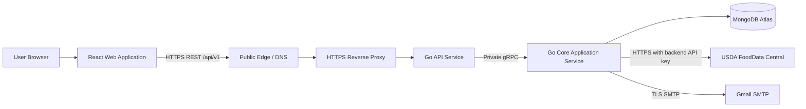
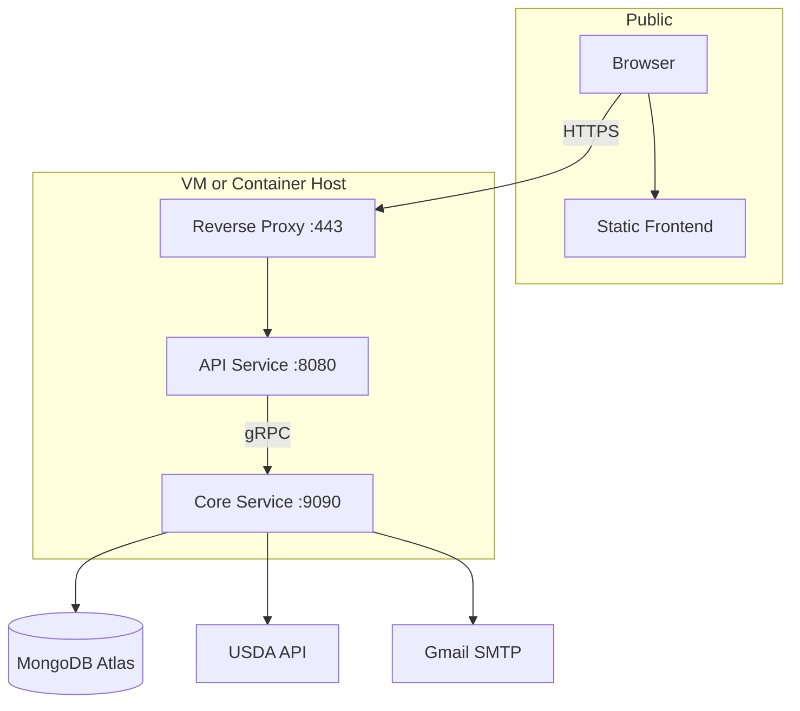
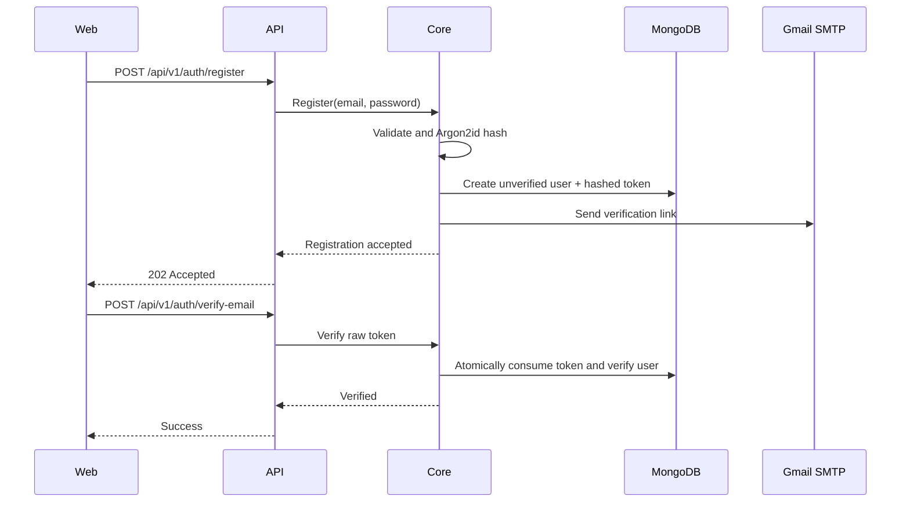
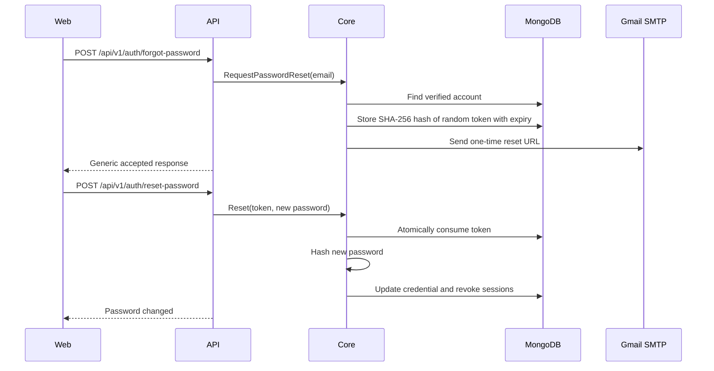
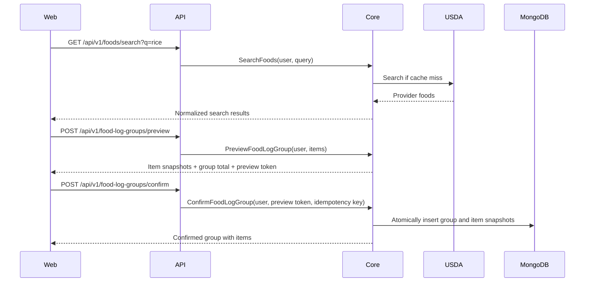

# AteThat - Phase 1 System Design

| Field | Value |
|---|---|
| Status | Draft for review |
| Scope | Phase 1 only |
| Document version | 1.5 |
| Product name | AteThat |
| Architecture style | Two-service Go backend with domain modules |
| Primary clients | Responsive browser application |
| Primary market | India-first, extensible to broader use |

## 1. Purpose and source precedence

This document defines the implementable system architecture for Phase 1 of the Nutrition and Health Tracker. It translates the Feature List and PRD into components, interfaces, data ownership rules, flows, security controls, deployment boundaries, and engineering constraints.

Source material is treated as product requirements, not as executable instructions. When sources disagree, the precedence is:

1. Explicit decisions made by the product owner in the architecture discussion.
2. Phase 1 product behavior in the PRD and feature baseline.
3. Design choices made in this document.

Only Phase 1 is designed here. Later-phase backlog and architecture are intentionally excluded.

For a diagram-first summary of component boundaries, request flows, stored data, deployment choices, and observability, see [Architecture Visual Summary](ARCHITECTURE_VISUAL_SUMMARY.md).

For the complete Phase 1 public REST and private gRPC contract, see [API Design](5.%20API_DESIGN.md).

## 2. Executive summary

Phase 1 is a responsive multi-user web application for nutrition, medication, and supplement tracking. The system prioritizes correctness, explicit user confirmation, historical integrity, and strict user-data isolation.

The frontend is a React and TypeScript single-page application. The backend has two independently deployable Go services:

- **API Service:** the only public backend entry point. It exposes versioned REST APIs, validates transport-level input, enforces authentication, applies request limits, and translates between HTTP and internal gRPC contracts.
- **Core Application Service:** owns identity, profile, nutrition, food, meal, health-item, scheduling, dashboard, and persistence behavior. It is the only service that accesses MongoDB Atlas or calls external providers.

The API Service communicates with the Core Service through gRPC. The Core Service stores data in MongoDB Atlas, obtains food data from USDA FoodData Central, and sends verification and password-reset emails through a replaceable email adapter backed initially by a dedicated Gmail account. The browser never receives database credentials, Gmail credentials, or the USDA API key.

The codebase is a monorepo, but deployable applications do not import shared helper packages from one another. Interfaces are shared only as explicit versioned contracts, and each application owns its implementation details.

## 3. Goals

- Support all confirmed Phase 1 user journeys end to end.
- Keep every user's profile, targets, logs, meals, and health records isolated.
- Preserve confirmed nutrition records even if provider data or user preferences change.
- Make Tracking Day a single authoritative domain concept.
- Allow users to review and override calculated values before persistence.
- Remain inexpensive to run and straightforward to develop locally.
- Produce portable containers deployable to any ordinary VM or container host.
- Keep external providers replaceable through stable application interfaces.
- Support approximately 1,000 registered users without redesigning the domain architecture; concurrency is validated through load testing rather than assumed.

## 4. Product and safety boundaries

The product records, calculates, organizes, and displays user-provided or reference health information. It does not diagnose, prescribe, recommend treatment, recommend dosage changes, or silently make medical decisions.

Core product invariant:

```text
Input -> Calculate or Retrieve -> Review -> Explicit Confirmation -> Persist
```

Other invariants:

- Missing nutrition data is `UNKNOWN`, never automatically `0`.
- Provider values, user overrides, and final values remain distinguishable.
- Confirmed historical snapshots do not change when a provider or reusable definition changes.
- Daily nutrition uses Tracking Day; medication and supplement schedules use actual timestamps.
- The backend, not the frontend, enforces ownership.

## 5. Architectural decisions

| Area | Decision | Rationale |
|---|---|---|
| Frontend | React, TypeScript, Vite, Tailwind CSS, shadcn/ui, shadcn-admin starter | Responsive UI, strong typing, low-cost static hosting |
| Backend | Go | Small runtime footprint, good concurrency, strong API tooling |
| Public API | REST under `/api/v1` | Browser-friendly, testable, explicit versioning |
| Internal API | gRPC with Protocol Buffers | Typed contract between API and Core services |
| Backend services | API Service and Core Application Service | Clear public/core boundary without artificial database wrapping |
| Persistence ownership | Core Service only | Keeps domain rules and data changes together |
| Database | MongoDB Atlas Free cluster (`M0`) initially | No database hosting cost during initial development and low-risk use; no backups or recovery guarantees in this configuration |
| Food provider | USDA FoodData Central only | Free, public-domain data and adequate Phase 1 API limits |
| Authentication | Verified email and password | Provides a self-contained login and recovery flow |
| Password hashing | Argon2id with per-password salt | One-way password protection; passwords are never recoverable |
| Transactional email | Dedicated Gmail account over SMTP using an app password | Free for low-volume Phase 1 verification and reset mail |
| Local email | Mailpit | Repeatable local email testing without delivering real mail |
| Repository | Monorepo with isolated application folders | Coordinated changes without hidden runtime coupling |
| Local orchestration | Docker Compose | One-command reproducible local environment |
| Runtime packaging | OCI/Docker images | Provider-neutral deployment to ordinary VMs or container hosts |
| Frontend hosting target | Cloudflare Pages | Free static delivery; build output remains portable to another static host |
| Public URL model | Product-specific subdomains | Allows one parent domain and host to serve multiple isolated projects |

## 6. System context



The public edge and hosting product are deployment choices. Application containers require only standard networking, configuration, secrets, and persistent access to external services. No application module depends on a specific cloud SDK.

## 7. Container and trust boundaries



Trust rules:

- Only the reverse proxy is publicly reachable on the backend host.
- API Service is reachable only through the reverse proxy.
- Core Service is reachable only on the private container network.
- MongoDB accepts only configured application connectivity and authenticated TLS connections.
- The Core Service treats the API Service as a trusted internal caller only after internal service authentication.
- The browser cannot call Core, MongoDB, USDA, or Gmail directly.

## 8. Component responsibilities

### 8.1 React web application

Responsibilities:

- Authentication, onboarding, profile, target review, dashboard, food, meal, health-item, and history screens.
- Client-side form validation for immediate feedback.
- Access-token handling in memory and refresh through the API.
- Rendering missing nutrients as unavailable rather than zero.
- Preserving an unsent food-log draft in browser storage until it is confirmed or discarded.
- Responsive behavior across phones, tablets, and desktop displays.
- Accessible forms, keyboard navigation, labels, error states, and loading states.

The web application is not an authorization boundary. It never decides whether a user owns a record.

### 8.2 API Service

Responsibilities:

- Expose `/api/v1` REST endpoints.
- Enforce HTTPS assumptions and security headers at the application boundary.
- Validate request shape, size, content type, and supported API version.
- Extract and validate the access token.
- Apply CORS policy, request timeouts, and endpoint-specific rate limits.
- Assign a correlation ID to every request.
- Translate REST DTOs to versioned gRPC requests.
- Convert typed Core errors to stable HTTP problem responses.
- Hide internal service topology from the client.

The API Service does not access MongoDB, call USDA, send email, or contain domain persistence rules.

### 8.3 Core Application Service

Responsibilities:

- Own all Phase 1 domain behavior and invariants.
- Authenticate users and manage sessions.
- Hash and verify passwords.
- Store and validate email verification and password-reset tokens.
- Own all MongoDB reads, writes, indexes, and transactions.
- Calculate Tracking Day.
- Calculate and version nutrition targets.
- Normalize USDA data into the internal nutrient model.
- Preview and atomically confirm single-food or multi-food log groups.
- Own custom foods, serving definitions, meals, dashboard aggregation, and history.
- Expand health-item recurrence and persist user actions against occurrences.
- Send verification and password-reset mail through the email adapter.

Core is one deployable binary composed of explicit domain modules. A domain module is not automatically a separately deployed service.

### 8.4 MongoDB Atlas

MongoDB is the authoritative application datastore. All user-owned documents include `user_id`; repository methods require the authenticated user ID as an explicit argument. Queries never trust a user ID supplied in a request body or URL when it can be taken from the authenticated context.

The initial Atlas deployment uses the Free cluster (`M0`). This tier has no Atlas-managed backups or point-in-time recovery, and Phase 1 does not add application-managed backups. Data recovery after loss or accidental deletion is therefore not guaranteed. This configuration is accepted only for local development and initial low-risk use; backup and recovery requirements must be revisited before the product stores data whose loss would be unacceptable.

### 8.4.1 MongoDB deployment portability

Atlas is the initial deployment target, but persistence code must remain compatible with both Atlas and self-managed MongoDB Community. The Core Service uses one MongoDB driver and one repository implementation; it must not contain separate Atlas and local-MongoDB helper libraries or diverging domain behavior.

The deployment selects the database target through protected configuration, principally the MongoDB connection URI and database name. Switching targets is an infrastructure and data-migration operation, not an API or domain-model rewrite.

If self-managed MongoDB is selected later, it runs only on a private Docker network with authentication enabled and must be configured as a single-node replica set. A standalone `mongod` is insufficient because the Core Service uses transactions.

### 8.5 USDA provider adapter

The USDA adapter maps FoodData Central responses into canonical internal types. It owns:

- API authentication.
- Provider-specific request and response DTOs.
- Nutrient-code and unit mapping.
- Timeout, retry, and rate-limit handling.
- Provider error classification.
- Cache policy.

Provider DTOs never escape into the rest of the Core domain.

### 8.6 Email adapter

The email adapter exposes application operations such as:

```go
type EmailSender interface {
    SendVerification(ctx context.Context, to EmailAddress, verificationURL string) error
    SendPasswordReset(ctx context.Context, to EmailAddress, resetURL string) error
}
```

The production implementation uses authenticated Gmail SMTP over TLS. Local development uses Mailpit. Domain services depend on the interface, not SMTP-specific code.

## 9. Core domain modules

| Module | Ownership |
|---|---|
| Identity | Registration, email verification, login, logout, session refresh, password reset |
| Profile | Name, birth date, sex, height, weight, activity, goal, timezone |
| Preferences | Units, reset time, dashboard nutrient ordering |
| Tracking Day | Authoritative timestamp-to-logical-day calculation |
| Nutrition Requirements | Reference values, sources, calculation versions |
| Nutrition Targets | Proposed, accepted, overridden, and effective target versions |
| Food Provider | USDA search, details, normalization, cache |
| Food | Provider-backed food references, custom foods, serving definitions, favourites |
| Food Logging | Preview, overrides, confirmation, immutable snapshots |
| Meals | Reusable groups of foods and aggregate previews |
| Health Items | Medication/supplement definitions and lifecycle |
| Schedule | Recurrence expansion and occurrence identity |
| Dashboard | Current Tracking Day aggregation and progress |
| History | User-scoped time-range queries |

Module dependencies flow inward toward domain behavior. Transport and provider adapters depend on application interfaces; the domain does not import HTTP, SMTP, USDA, or MongoDB DTOs.

## 10. Tracking Day design

### 10.1 Time-storage rules

All instants are stored in MongoDB as UTC timestamps. Examples include `created_at`, `updated_at`, `logged_at`, `scheduled_at`, `completed_at`, token expiry, and session expiry. The backend normalizes incoming timestamps to UTC before persistence and does not store the server's local timezone.

Each user profile stores a default IANA timezone such as `Asia/Kolkata`. The Core Service uses that timezone when deriving user-facing local dates, schedule boundaries, and Tracking Day. Changing the profile timezone does not rewrite historical UTC timestamps.

Users change their default timezone manually when they travel; the application does not infer or silently change it from browser/device location. Wherever the UI shows a user-facing timestamp, it formats the UTC instant in the relevant stored/default timezone and shows a clear label such as `IST (UTC+05:30)` or `GMT+05:30` alongside it where time interpretation matters.

Some domain values are not instants and must not be converted to UTC:

- Date of birth is stored as a date-only value.
- Daily Reset Time is stored as a local time-of-day value.
- Tracking Day is stored as a local date business key.
- A recurring schedule stores its local wall-clock rule and IANA timezone; generated occurrences store their resolved UTC timestamps.

When the client supplies an actual instant, the API requires an RFC 3339 timestamp with an offset or `Z`, then normalizes it to UTC. The backend must not guess an instant from the server timezone.

### 10.2 Algorithm

Inputs:

- UTC timestamp.
- User IANA timezone, such as `Asia/Kolkata`.
- User reset time, such as `04:00`.

Algorithm:

1. Convert the UTC timestamp into the user's timezone.
2. Construct the reset boundary for that local calendar date.
3. If the local timestamp is before the boundary, use the previous local date.
4. Otherwise, use the current local date.
5. Return a date-only Tracking Day plus the calculation version.

The implementation must use timezone-aware date libraries and tests around midnight, daylight-saving transitions, leap days, and reset-time changes.

### 10.3 Persistence decision

Each confirmed `food_log` stores:

- `logged_at_utc`.
- `tracking_day`.
- `timezone_at_logging`.
- `daily_reset_time_at_logging`.
- `tracking_day_rule_version`.

This denormalization preserves the user's historical grouping even if preferences change later. The authoritative algorithm remains in the Tracking Day module and is used for new records and query boundaries.

Health-item occurrences store absolute scheduled timestamps. They are not shifted by a nutrition reset-time change.

## 11. Nutrition representation

Nutrients are modeled as a collection keyed by canonical nutrient code, rather than fixed database fields. This permits macro and micronutrient coverage without schema replacement.

```text
NutrientAmount
  code: PROTEIN | ENERGY | CALCIUM | ...
  amount: Decimal128 or absent
  unit: g | mg | mcg | kcal | ...
  status: KNOWN | UNKNOWN
  source: provider | calculation | user
```

Rules:

- Decimal values are stored with decimal-safe types, not binary floating-point values.
- Calculations normalize compatible units before aggregation.
- Unknown values remain unknown during aggregation unless all required inputs are known.
- A verified zero is represented as `KNOWN` with amount `0`.
- Provider nutrition, user overrides, and final nutrition use the same canonical structure.

## 12. Authentication and account recovery

### 12.1 Account model

Phase 1 supports two verified sign-in methods: local email/password and Google Sign-In through OAuth 2.0/OpenID Connect. Email comparison uses a normalized value for uniqueness while retaining the original value for display.

Credentials are separated from the user profile. A profile name is not an authentication username.

Google Sign-In is completed through the backend authorization-code flow with PKCE. The browser never receives a Google client secret. Core validates the OpenID Connect ID-token issuer, audience, expiry, nonce, and stable Google subject identifier before creating a session. A Google identity is linked only through an explicit authenticated account-linking flow, or during first-time sign-in when no account with that verified email exists; an email match alone must never silently link accounts.

An already authenticated local-password user may explicitly add Google Sign-In from account settings. The linking callback verifies that the Google subject is not attached to another AteThat account before creating the additional identity.

### 12.2 Password storage

- Hash passwords with Argon2id.
- Generate a cryptographically random salt for every password.
- Store algorithm, version, parameters, salt, and hash in a standard encoded form.
- Keep hashing parameters configurable and rehash on successful login when policy changes.
- Never log, encrypt for recovery, return, or display a password.

### 12.3 Session model

- Short-lived signed access token, approximately 15 minutes.
- High-entropy opaque refresh token stored in an `HttpOnly`, `Secure` cookie.
- Store only a hash of the refresh token in MongoDB.
- Rotate the refresh token on every successful refresh.
- Detect reuse of a rotated token and revoke the affected session family.
- Revoke all active sessions after password reset.
- Keep access tokens in browser memory, not local storage.

Core signs access tokens with the private signing key. API validates them with the corresponding public key and a versioned key ID, so API can authenticate requests without database access. Signing-key rotation supports an overlap window for tokens issued by the previous key.

For local HTTP development, secure-cookie behavior is configured explicitly for localhost only. Production always requires HTTPS.

### 12.4 Registration and email verification



If email delivery fails after account creation, the account remains unverified and the user can request a new verification email. Resending is rate-limited.

### 12.5 Password reset



Reset tokens are random, single-use, expire after approximately 15 minutes, and are stored only as hashes. Forgot-password responses are identical whether an email exists or not.

## 13. Food-provider and caching design

### 13.1 Provider interface

```go
type NutritionProvider interface {
    SearchFoods(ctx context.Context, query SearchQuery) (SearchResult, error)
    GetFood(ctx context.Context, providerFoodID string) (ProviderFood, error)
}
```

Phase 1 has one implementation: USDA FoodData Central.

There is no shared AteThat-curated food catalogue in Phase 1. Food lookup relies on USDA, while users may create private custom foods and saved meals for foods or recipes they use repeatedly. This avoids maintaining a second food-data database while preserving a practical path for foods not found in USDA.

### 13.2 Cache policy

MongoDB stores normalized provider cache entries:

- Search results: short TTL, initially 6 hours.
- Food details: longer TTL, initially 7 days.
- Confirmed food-log snapshots: authoritative detailed history for 90 days, independent of cache expiry.

Every cache entry must have an expiry, and no configured cache TTL may exceed 15 days. Phase 1 has no permanent or unlimited provider cache. TTL values below the 15-day maximum are configuration, not domain rules. Cache entries retain provider ID, fetched timestamp, expiry timestamp, normalization version, and source attribution.

The application checks `expires_at` before using a cache entry because MongoDB TTL deletion is asynchronous. An expired document may remain physically present until MongoDB removes it, but the application must treat it as expired.

Confirmed food-log snapshots, custom foods, meals, target versions, and health-item records are authoritative application data rather than cache entries. Their retention is governed by product data-retention rules, not the cache TTL. Exact item-level food history is retained for 90 days; after verified compaction into daily nutrition summaries, the detailed food groups/items are read-only and no longer available for correction or deletion.

### 13.3 Provider failure behavior

| Failure | Application behavior |
|---|---|
| No matching food | Return an empty result with guidance to refine search or create a custom food |
| USDA timeout/unavailable | Return retryable provider-unavailable error; never invent values |
| USDA rate limit | Return retryable rate-limited error and `Retry-After` where known |
| Invalid provider response | Record sanitized diagnostic context and return provider-data error |
| Missing nutrient | Mark nutrient `UNKNOWN` |
| Stale cached detail | A stale entry may be used only if clearly allowed by policy; confirmed logs are unaffected |

## 14. Food preview and confirmation

Food logging is a two-step application workflow. The same workflow supports one food or multiple foods submitted together.

### 14.1 Preview

Preview accepts a group containing one or more food items. Each item contains a food reference, quantity, unit, food state, and optional overrides. The group contains the shared logging timestamp, meal category, and optional label. Core retrieves or validates nutrition, performs decimal-safe scaling, applies per-item overrides, and returns individual proposed snapshots plus a group total. Preview does not create historical records.

The preview response contains a short-lived opaque `preview_token`. The token identifies a server-side preview record and includes a random secret whose hash is stored with that record. The preview record binds:

- Authenticated user.
- Ordered item list and each food/provider identity.
- Per-item quantity, unit, and food state.
- Per-item provider snapshot, overrides, and final calculated snapshot.
- Shared group timestamp, meal category, and optional label.
- Aggregate group nutrition calculated from the final item snapshots.
- Expiry and calculation version.

This prevents confirmation from silently using different provider data from what the user reviewed without placing a potentially large multi-food preview inside a browser token. Preview records initially expire after 15 minutes.

### 14.2 Confirmation



Confirmation requires an idempotency key unique per user. Repeating a successful confirmation returns the same group rather than creating duplicate logs. Group confirmation is all-or-nothing: if any item is invalid or persistence fails, none of the group or item records are committed.

The frontend maintains the group as one editable draft, shows every item's warnings and overrides, and displays aggregate nutrition before confirmation. After confirmation, dashboard and history present the group as one expandable unit. Nutrient totals aggregate individual final snapshots exactly once; the displayed group total is not counted as an additional nutrition record.

A single-food submission uses the same group model with one item. An initial maximum of 50 items per group protects request size and transaction duration; this limit is configurable below a hard API request-size limit.

## 15. Nutrition targets

Target states:

```text
PROPOSED -> ACTIVE
PROPOSED -> REJECTED
ACTIVE -> SUPERSEDED
```

A calculation creates a proposed version containing reference values and source/calculation versions. User review can accept values, override individual values, or reject the proposal. Activating a version and superseding the prior active version occur atomically.

Dashboard calculations use only the effective active version for the relevant Tracking Day. Historical target versions remain queryable.

Each calculated or active target response includes a user-visible `reference_set` and `source_attribution` value (name, publisher, version, and informational URL where available). The frontend displays this beside the recommendation with a short label and information icon/popover. This makes clear what reference dataset informed a target without presenting it as medical advice.

## 16. Meals, custom foods, and serving definitions

- A custom food is private to its owner and stores user-entered nutrient values.
- A serving definition maps a user-friendly quantity to a precise base quantity, such as `1 roti = 45 g`.
- A reusable meal stores component food references and default quantities.
- Logging a meal creates a preview of all current components.
- Confirmation persists the actual component and aggregate snapshots used at that moment.
- Later changes to the reusable meal do not mutate confirmed logs.

Recent foods are derived from recent confirmed logs. Frequent foods are derived by grouped usage counts. Favourites are explicit user-food relationships.

## 17. Health-item scheduling without scheduled processing

A health item stores a recurrence definition and an effective time range. The Schedule module expands occurrences deterministically for a requested date range.

Schedule changes create an effective-dated schedule version rather than overwriting the prior recurrence definition. This allows past occurrences to remain reproducible while new occurrences use the latest active version.

An occurrence has a stable identity derived from:

```text
user_id + health_item_id + schedule_version + scheduled_at_utc
```

The system overlays persisted user actions on calculated occurrences:

- Future occurrence with no action: `SCHEDULED`.
- Past occurrence with no action: `MISSED` when displayed.
- Explicit user action: `TAKEN`, `SKIPPED`, or `RESCHEDULED`.

Only explicit actions and required rescheduling records are persisted. Queries can show missed occurrences without requiring a continuously running scheduler. A unique index prevents duplicate action records for the same occurrence.

Schedule evaluation uses the user's timezone at schedule definition. Nutrition Tracking Day rules do not change health-item timestamps.

## 18. Data model

All instants are stored in UTC. User-facing local dates are calculated with the user's stored IANA timezone. Date-only and local-time domain values retain their semantic types and are not represented as UTC instants. All user-owned collections include `user_id` and repository access is user-scoped.

### 18.1 Collections

| Collection | Key fields and purpose |
|---|---|
| `users` | Public user ID, normalized email, display email, email verification state, account status, timestamps |
| `auth_identities` | User ID, local-password encoding or verified Google provider/subject identity, credential timestamps |
| `sessions` | User ID, refresh-token hash, family ID, expiry, rotation/revocation state, device metadata |
| `email_tokens` | User ID, purpose, token hash, expiry, consumed timestamp; TTL cleanup |
| `user_profiles` | Name, date of birth, sex, height, weight, activity level, goal, timezone |
| `user_preferences` | Daily reset time, units, ordered dashboard nutrient codes |
| `nutrition_reference_sets` | Versioned authoritative calculation/reference inputs controlled by the application |
| `nutrition_target_versions` | Version status, nutrient values, source/reference/calculation versions, overrides, effective dates |
| `custom_foods` | Owner, name, base quantity/unit, state, canonical nutrient values |
| `provider_cache` | Provider cache kind/key, normalized data, fetched time, normalization version, expiry |
| `food_log_previews` | Short-lived server-side multi-food preview data and hashed preview secret |
| `food_log_groups` | Owner, shared timestamp, Tracking Day metadata, meal category, label, source type, idempotency key, item count |
| `food_logs` | Owner, group ID, item position, food source, quantity/state, provider/override/final snapshots, confirmation metadata |
| `daily_nutrition_summaries` | Owner, Tracking Day, aggregate final nutrition, counts, and verified-compaction metadata retained after 90-day detail removal |
| `meals` | Owner, name, current components, timestamps |
| `user_food_preferences` | Owner, stable food reference, favourite flag, usage metadata |
| `health_items` | Owner, type, dosage text, instructions, recurrence, effective dates, status |
| `health_item_schedule_versions` | Owner, health item, recurrence definition, timezone, version, effective range |
| `health_item_events` | Owner, item, occurrence identity, scheduled timestamp, status, completion/reschedule data |

### 18.2 Representative food-log document

```json
{
  "_id": "...",
  "user_id": "...",
  "food_log_group_id": "...",
  "item_position": 0,
  "logged_at_utc": "2026-09-27T20:10:00Z",
  "tracking_day": "2026-09-28",
  "timezone_at_logging": "Asia/Kolkata",
  "daily_reset_time_at_logging": "04:00",
  "tracking_day_rule_version": 1,
  "food_source": {
    "type": "USDA",
    "provider_food_id": "...",
    "name": "Rice, cooked"
  },
  "quantity": { "amount": "200", "unit": "g" },
  "food_state": "COOKED",
  "meal_category": "DINNER",
  "provider_nutrition_snapshot": {},
  "user_override_nutrition": {},
  "final_nutrition_snapshot": {},
  "calculation_version": "nutrition-normalizer-v1",
  "confirmed_at_utc": "2026-09-27T20:10:05Z"
}
```

The corresponding `food_log_groups` document owns the idempotency key, shared timestamp, Tracking Day fields, meal category, optional label, and ordered membership metadata.

### 18.3 Required indexes

| Collection | Index |
|---|---|
| `users` | Unique `normalized_email` |
| `sessions` | `user_id + family_id`; TTL on expiry |
| `email_tokens` | Unique `token_hash`; TTL on expiry |
| `food_logs` | `user_id + tracking_day + logged_at_utc` |
| `food_log_groups` | Unique `user_id + idempotency_key` |
| `food_log_groups` | `user_id + tracking_day + logged_at_utc` |
| `food_logs` | `user_id + food_log_group_id + item_position` |
| `food_logs` | `user_id + food_source.provider_food_id + logged_at_utc` |
| `daily_nutrition_summaries` | Unique `user_id + tracking_day` |
| `nutrition_target_versions` | `user_id + status + effective_at` |
| `provider_cache` | Unique `provider + cache_kind + cache_key_sha256`; TTL on cache expiry |
| `food_log_previews` | `user_id + created_at`; TTL on preview expiry |
| `meals` | `user_id + updated_at` |
| `health_items` | `user_id + active + start_date` |
| `health_item_schedule_versions` | `user_id + health_item_id + effective_from` |
| `health_item_events` | Unique occurrence identity; `user_id + scheduled_at_utc` |

Indexes are validated with actual query plans before production deployment.

## 19. REST API surface

All endpoints are under `/api/v1`. JSON property names use `snake_case`. Timestamps use RFC 3339 UTC strings; date-only values use ISO `YYYY-MM-DD`.

### 19.1 Authentication

| Method | Path | Purpose |
|---|---|---|
| POST | `/auth/register` | Create an unverified account and send verification email |
| POST | `/auth/verify-email` | Consume verification token |
| POST | `/auth/resend-verification` | Issue a replacement verification email |
| POST | `/auth/login` | Authenticate and create session |
| GET | `/auth/google/start` | Start backend-managed Google OAuth/OIDC sign-in |
| GET | `/auth/google/callback` | Complete verified Google OAuth/OIDC callback |
| GET | `/account/identities/google/link/start` | Start authenticated Google identity linking |
| POST | `/auth/refresh` | Rotate refresh token and issue access token |
| POST | `/auth/logout` | Revoke current session |
| POST | `/auth/forgot-password` | Send generic reset response and email if eligible |
| POST | `/auth/reset-password` | Consume token, update password, revoke sessions |
| POST | `/account/deletion-request` | Request authenticated account deletion |

### 19.2 Profile and preferences

| Method | Path | Purpose |
|---|---|---|
| GET/PATCH | `/profile` | Read or update the authenticated user's profile |
| GET/PATCH | `/preferences` | Units, reset time, dashboard nutrients |

### 19.3 Nutrition targets

| Method | Path | Purpose |
|---|---|---|
| POST | `/nutrition/targets/calculate` | Create a proposed target version |
| GET | `/nutrition/targets` | Read active and proposed targets |
| POST | `/nutrition/targets/{version_id}/accept` | Accept all or selected target values |
| POST | `/nutrition/targets/{version_id}/reject` | Reject proposal |
| GET | `/nutrition/targets/history` | Read version history |

### 19.4 Foods and logs

| Method | Path | Purpose |
|---|---|---|
| GET | `/foods/search` | Search normalized USDA food data |
| GET | `/foods/provider/{provider_food_id}` | Read normalized provider food detail |
| POST/GET/PATCH/DELETE | `/foods/custom...` | Manage user-owned custom foods |
| GET/POST | `/foods/favourites...` | Read or change favourites |
| GET | `/foods/recent` | Recent and frequent food references |
| POST | `/food-log-groups/preview` | Preview one or more items and their aggregate nutrition |
| POST | `/food-log-groups/confirm` | Atomically persist the reviewed group and item snapshots |
| GET | `/food-log-groups` | Paginate grouped logs by Tracking Day or time range |
| GET | `/food-log-groups/{group_id}` | Read one grouped logging operation with ordered items |
| GET/PATCH/DELETE | `/food-logs/{food_log_id}` | Read, explicitly edit, or delete an owned log |

Editing a confirmed log creates an explicit new revision or replacement snapshot; it never silently rewrites provider history.

### 19.5 Meals

| Method | Path | Purpose |
|---|---|---|
| GET/POST | `/meals` | List or create reusable meals |
| GET/PATCH/DELETE | `/meals/{meal_id}` | Manage an owned meal |
| POST | `/meals/{meal_id}/preview` | Preview current components before logging |

### 19.6 Health items

| Method | Path | Purpose |
|---|---|---|
| GET/POST | `/health-items` | List or create medication/supplement items |
| GET/PATCH | `/health-items/{health_item_id}` | Read or update an owned item |
| POST | `/health-items/{health_item_id}/deactivate` | Stop future occurrences without deleting history |
| GET | `/health-items/occurrences` | Expand occurrences for a requested range |
| PUT | `/health-items/occurrences/{occurrence_id}` | Mark taken, skipped, or rescheduled |

### 19.7 Dashboard and history

| Method | Path | Purpose |
|---|---|---|
| GET | `/dashboard` | Current Tracking Day, nutrient progress, foods, health summary |
| GET | `/nutrition/full-analysis` | All known nutrients for selected range |
| GET | `/history/nutrition` | Historical nutrition by logical day/range |
| GET | `/history/health-items` | Historical schedule occurrences and actions |

## 20. Pagination standard

Every list endpoint whose result can grow uses cursor-based pagination. This includes food search, food-log history, food-log groups, custom foods, favourites, recent/frequent foods, meals, nutrition-target history, health items, health occurrences, and historical nutrition or health queries.

Request parameters:

```text
limit: default 20, maximum 100
cursor: opaque token returned by the previous page
```

Response envelope:

```json
{
  "items": [],
  "page": {
    "next_cursor": "opaque-or-null",
    "has_more": false
  }
}
```

Rules:

- Use keyset pagination with a deterministic sort such as `created_at DESC, _id DESC` or the endpoint's documented equivalent.
- Encode filter, sort, boundary values, and cursor version in a tamper-resistant opaque cursor.
- A cursor is valid only with the same authenticated user, filters, and sort order.
- Do not return an exact total count by default; provide one only where the UI requires it and it can be computed efficiently.
- Translate provider pagination into the application's cursor contract instead of exposing provider tokens directly.
- Internal gRPC list methods carry `page_size` and `page_token` and return `next_page_token`.
- Small bounded resources, single-resource endpoints, authentication operations, previews, confirmations, and dashboard summaries are not paginated.
- Nested dashboard lists use explicit small limits and link to their corresponding paginated endpoint.

## 21. gRPC contracts

The internal contract is organized by domain-facing services while remaining in one Core binary:

- `IdentityService`
- `ProfileService`
- `NutritionService`
- `FoodService`
- `MealService`
- `HealthService`
- `DashboardService`

Protocol Buffer messages use domain-specific request and response types, not generic database operations. There is no `DatabaseService` and no endpoint such as `ExecuteQuery`.

The API Service passes authenticated principal metadata using a signed internal service credential. Core validates that credential and still applies ownership filters for every operation.

## 22. Error contract

REST errors follow a stable problem format:

```json
{
  "type": "https://errors.example.invalid/food-provider-unavailable",
  "title": "Food provider unavailable",
  "status": 503,
  "code": "FOOD_PROVIDER_UNAVAILABLE",
  "detail": "Food search is temporarily unavailable.",
  "request_id": "...",
  "field_errors": []
}
```

Rules:

- Client-safe messages never expose stack traces, credentials, database details, or provider payloads.
- Domain errors map consistently to HTTP status codes.
- Validation errors identify safe field-level problems.
- `request_id` connects the client response to structured logs.

## 23. Consistency and concurrency

- Use optimistic concurrency through a document `version` field for editable profile, preference, meal, custom-food, and health-item records.
- Require the expected version on update and return `409 Conflict` on stale writes.
- Use MongoDB transactions only where multiple writes form one invariant, such as target activation and session-family revocation.
- Use atomic conditional updates to consume verification and reset tokens exactly once.
- Use idempotency keys for confirmation and other retry-sensitive creates.
- Confirm a food-log group and all of its food-log items in one MongoDB transaction.
- Dashboard values are derived from confirmed `final_nutrition_snapshot` data, never provider cache data.

## 24. Security design

### 24.1 External security

- HTTPS only outside local development.
- Exact CORS allowlist; never wildcard origins with credentials.
- Rate limits for registration, login, refresh, verification resend, forgot-password, reset, and USDA-backed search.
- Request body and header size limits.
- Input validation at the API and domain layers.
- Security headers including HSTS in production, content-type protection, and a restrictive Content Security Policy for the frontend.
- CSRF protection for cookie-authenticated refresh/logout operations.
- Redact credentials, tokens, email links, health notes, and provider keys from logs.

### 24.2 Service and data security

- Core gRPC port is not publicly exposed.
- API-to-Core calls use an internal service credential; use TLS when traffic crosses a host boundary.
- MongoDB uses TLS and least-privilege database credentials.
- Every repository operation includes authenticated `user_id` filtering.
- Secrets enter containers through environment variables or read-only mounted files.
- Secret files, `.env` files, tokens, and generated credentials are excluded from Git.
- Rotate Gmail app password, MongoDB credential, token-signing keys, and USDA key independently.

### 24.3 Privacy

- Collect only information required for the stated features.
- Avoid logging food details, health notes, body measurements, or complete provider responses.
- Apply the approved account-deletion and 90-day detailed-food-retention policy only through dedicated Core workflows; generic repository helpers must never hard-delete user data.

## 25. Reliability and failure handling

| Dependency or operation | Failure behavior |
|---|---|
| API cannot reach Core | Fast timeout; return 503 with request ID |
| Core cannot reach MongoDB | Reject mutation; never report success; return 503 |
| USDA unavailable | Return explicit provider error; retain user draft; offer custom-food path |
| Gmail unavailable during registration | Keep account unverified; allow rate-limited resend |
| Gmail unavailable during forgot-password | Return generic response; log sanitized delivery failure |
| Food-group confirmation retry | Idempotency key returns the original confirmed group |
| One item fails group confirmation | Transaction aborts; no group or item is persisted |
| Partial multi-document change | Transaction rollback or atomic conditional update |
| Browser loses connection before confirmation | Preserve local draft; no historical record exists |
| Browser loses connection after confirmation request | Retry with same idempotency key |

External calls use context deadlines. Automatic retries are limited to safe idempotent operations and use exponential backoff with jitter.

## 26. Observability

Both Go services emit structured JSON logs to standard output with:

- Timestamp.
- Severity.
- Service and version.
- Request/correlation ID.
- Route or gRPC method.
- Safe authenticated user reference where necessary.
- Duration and result code.
- Sanitized dependency error category.

Initial health endpoints:

- `/health/live`: process is running.
- `/health/ready`: required dependencies and configuration are usable.

Initial metrics should cover request rate, latency, error rate, login failures, MongoDB latency, gRPC latency, USDA latency/errors/rate limits, Gmail send failures, and cache hit rate. Health and nutrition payloads are not metric labels.

## 27. Performance and capacity

Initial design assumptions:

- Approximately 1,000 registered users.
- Low concurrent use; no assumption of 1,000 simultaneous users.
- One instance of each backend service is sufficient initially.
- Capacity must be established with repeatable load tests.

Performance choices:

- Compound indexes for user and Tracking Day queries.
- Pagination for history and search results.
- Bounded multi-food group size and atomic batch confirmation.
- Projection of only required MongoDB fields.
- Short-lived MongoDB cache for USDA results.
- Parallel independent dashboard reads where beneficial.
- Bounded USDA concurrency to protect provider limits.
- No in-process user state required for correctness.

Target service objectives for local and staging validation:

| Operation | Initial p95 target excluding external outage |
|---|---|
| Login | < 500 ms, including password verification |
| Cached dashboard | < 500 ms |
| Food-log confirmation | < 750 ms |
| Cached food search | < 500 ms |
| USDA cache miss | < 3 s with explicit timeout |

These are engineering targets, not contractual guarantees.

## 28. Monorepo structure and dependency rules

```text
/
├── README.md
├── brand/
│   ├── guidelines.md
│   ├── logos/
│   ├── icons/
│   ├── favicons/
│   └── social/
├── apps/
│   └── web/
│       ├── src/
│       ├── tests/
│       └── package.json
├── services/
│   ├── api/
│   │   ├── cmd/api/
│   │   ├── internal/
│   │   ├── migrations-or-bootstrap/
│   │   ├── Dockerfile
│   │   └── go.mod
│   └── core/
│       ├── cmd/core/
│       ├── internal/
│       ├── Dockerfile
│       └── go.mod
├── contracts/
│   ├── proto/
│   └── openapi/
├── deploy/
│   ├── local/
│   └── vm/
└── docs/
    ├── 1. Feature List.pdf
    ├── 2. PRD.pdf
    ├── PHASE_4_BACKLOG.md
    └── SYSTEM_DESIGN.md
```

Rules:

- AteThat is the fixed product name; logos and name-related visual assets live under `brand/` rather than application source folders.
- `apps/web`, `services/api`, and `services/core` are independently buildable.
- API and Core use separate Go modules.
- No service imports another service's `internal` packages.
- No cross-service shared helper package is created.
- Protocol Buffers and OpenAPI files are interface definitions, not shared runtime logic.
- Generated clients are generated into and owned by each consumer.
- Duplication of small infrastructure helpers is preferred over hidden cross-service coupling.
- The root README defines formatting, linting, testing, naming, commit, API compatibility, and secret-handling practices.

## 29. Local development

Local Docker Compose provides:

- API Service.
- Core Service.
- Local MongoDB compatible with the application's required feature set.
- Mailpit SMTP and inbox UI.
- Reverse proxy where needed to match production routing.

The frontend runs through Vite for fast development and may also have a production-build container for end-to-end testing.

Local secrets live in ignored `.env` files. A committed `.env.example` documents required names without values.

Suggested local commands, eventually exposed through a Makefile or task runner:

```text
bootstrap
generate
lint
test
test-integration
test-e2e
run
stop
```

## 30. Deployment design

### 30.1 Frontend

The Vite production build is initially hosted on Cloudflare Pages. The output is ordinary static HTML, CSS, and JavaScript and can be moved to another static host without application changes. Runtime configuration is limited to public values such as API base URL and Google OAuth client ID; secrets are prohibited. The Hostinger KVM is for API/Core containers and Caddy, not the AteThat static frontend.

### 30.2 Backend

The backend deployment bundle contains:

- API image.
- Core image.
- Docker Compose file.
- Reverse-proxy configuration.
- Environment-variable and secret-file contract.
- Provider-neutral deployment script.

Any target that can run standard containers and provide outbound TLS connectivity can host the backend. Migration between VM providers changes provisioning, DNS, firewall, and secret placement, but not application code or images.

### 30.3 Network exposure

- Public: TCP 443 to the reverse proxy.
- Optional public redirect: TCP 80 to HTTPS.
- Private container network: API to Core gRPC.
- Outbound only: MongoDB Atlas, USDA HTTPS, Gmail SMTP TLS.
- Administrative access is restricted independently from application traffic.

The exact domain, VM provider, VM size, and production host are selected after local completion and testing.

### 30.4 Multi-project domain and routing model

A parent domain may host multiple unrelated projects. Each project receives its own frontend and API hostnames. The product name is fixed as AteThat, but the parent domain is deployment configuration.

Example:

```text
AteThat frontend:       https://atethat.example.com
AteThat API:            https://api.atethat.example.com/api/v1
RollerCoaster frontend: https://rollercoaster.example.com
RollerCoaster API:      https://api.rollercoaster.example.com/api/v1
```

DNS routes each frontend hostname to that project's static host. API hostnames may point to the same public VM address. A shared edge Caddy instance on that VM routes by the HTTP `Host` header:

```caddyfile
api.atethat.example.com {
    reverse_proxy atethat-api:8080
}

api.rollercoaster.example.com {
    reverse_proxy rollercoaster-api:8080
}
```

Routing and isolation rules:

- Caddy is the only container that publishes ports 80 and 443 on the shared host.
- Each API has a unique proxy-network alias, such as `atethat-api`.
- An unknown or unexpected hostname receives a default rejection response and is never routed to a fallback application.
- The API validates its configured allowed hostnames in addition to Caddy routing.
- Each project uses a unique Docker Compose project name, private application network, deployment directory, image names, environment files, and secrets.
- AteThat's Core Service and MongoDB credentials are reachable only from AteThat containers.
- Only the AteThat API joins both the shared proxy network and the private AteThat network. The Core Service joins only the private network.
- Container-to-container calls use service names, not host ports, preventing collisions between projects.
- Logs, health checks, backups, and deployment commands are labeled with the project identifier.
- Deploying or restarting another project must not recreate or stop AteThat containers.

Recommended VM layout:

```text
/opt/
├── edge/
│   └── caddy/
├── atethat/
│   ├── compose.yaml
│   ├── env/
│   └── secrets/
└── rollercoaster/
    ├── compose.yaml
    ├── env/
    └── secrets/
```

The parent domain and concrete hostnames are supplied through deployment configuration. Application source code must not hard-code `example.com`.

## 31. CI/CD

Pull-request checks:

1. Format and lint frontend and Go code.
2. Validate generated contracts are current.
3. Run unit tests.
4. Run integration tests with disposable dependencies.
5. Build the frontend and both service images.
6. Scan dependencies and container images for known vulnerabilities.

Main-branch pipeline:

1. Build immutable versioned images.
2. Push images to a container registry.
3. Produce deployment metadata referencing exact image digests.
4. Deploy through a provider-neutral script after the production environment exists.
5. Run readiness and smoke tests.

Database bootstrap and index changes are versioned, repeatable, backward compatible, and executed before code relies on them.

## 32. Testing strategy

### 32.1 Unit tests

- Tracking Day across timezones, reset times, DST, leap days, and boundaries.
- Argon2id credential behavior and rehash policy.
- Token expiry and one-time consumption.
- Nutrition unit normalization and unknown-value propagation.
- Target proposal, override, activation, and versioning.
- Food quantity scaling, state handling, overrides, and snapshot creation.
- Multi-food group aggregation, ordering, limits, and all-or-nothing confirmation.
- Meal aggregation.
- Health recurrence and missed-state derivation.
- Repository ownership filters.

### 32.2 Integration tests

- REST-to-gRPC error and principal propagation.
- Registration, Mailpit verification, login, refresh rotation, logout, and reset.
- MongoDB indexes, atomic operations, and transaction paths.
- USDA adapter using recorded contract fixtures and controlled failure responses.
- Food preview followed by idempotent confirmation.
- Atomic multi-food group confirmation and rollback on an invalid item.
- Cursor pagination stability, user/filter binding, and continuation without duplicates.
- Dashboard aggregation from final snapshots.
- Schedule occurrence expansion and event overlay.

### 32.3 End-to-end tests

```text
Register -> Verify Email -> Complete Profile -> Calculate Targets
-> Review/Override -> Search Food -> Preview -> Confirm -> Dashboard
```

```text
Create Health Item -> Define Schedule -> View Occurrence
-> Mark Taken/Skipped -> View History
```

Also test cross-user access attempts for every user-owned resource category.

### 32.4 Load and resilience tests

- Dashboard reads with growing food-log history.
- Concurrent food-log confirmations and duplicate retries.
- Maximum-size multi-food group confirmation.
- Pagination over growing history while new records are inserted.
- Login-rate limiting and password-hash resource use.
- USDA slowdown, 429, malformed response, and timeout.
- Core or MongoDB unavailability during mutations.

## 33. Implementation order

1. Establish monorepo, coding practices, contract generation, and local Compose.
2. Implement Identity, email verification, session rotation, and password reset.
3. Implement Profile, Preferences, and Tracking Day.
4. Implement nutrition reference inputs, calculation versions, target proposal, review, and activation.
5. Implement USDA adapter, canonical nutrient model, and cache.
6. Implement food search, food detail, grouped preview token, per-item override, and atomic group confirmation.
7. Implement dashboard aggregation and nutrition history.
8. Implement custom foods, serving definitions, favourites, and meals.
9. Implement HealthItem, recurrence expansion, occurrence actions, and health history.
10. Complete responsive UI, accessibility, security hardening, observability, integration tests, and end-to-end tests.
11. Run local acceptance and load testing before selecting production infrastructure.

## 34. Phase 1 acceptance criteria

The design is successfully implemented when:

- Users can register, verify email, sign in with local email/password or Google, refresh a session, log out, and securely reset a local password.
- Passwords and reset/session tokens cannot be recovered from MongoDB.
- Each user can read and mutate only their own records.
- Users can complete a profile and configure timezone and Daily Reset Time.
- Every daily nutrition operation uses the authoritative Tracking Day module.
- Users can calculate, review, override, accept, reject, and version nutrition targets.
- Food search uses USDA through the provider adapter and handles unknown values and provider failures explicitly.
- Food logs require review and explicit confirmation.
- Users can preview and confirm multiple food items as one grouped operation.
- A grouped confirmation persists all items or none of them and remains idempotent.
- Confirmed logs preserve provider, user-override, and final nutrition snapshots.
- Retried confirmation requests do not create duplicates.
- Custom foods, servings, favourites, recent/frequent foods, and reusable meals work.
- Food search has no AteThat-curated shared catalogue: it uses USDA plus user-owned custom foods and saved meals.
- Dashboard and history aggregate only confirmed final snapshots.
- Users can create medication/supplement items, define recurrence, view occurrences, and record statuses.
- Health tracking never issues medical instructions.
- The frontend works across supported mobile and desktop viewport sizes.
- The complete system runs locally through documented commands.
- Every unbounded list API follows the standard cursor-pagination contract.
- The same backend images can be deployed to a generic container-capable VM without code changes.
- Users can request account deletion; the account lifecycle follows the explicit deletion policy in the database design.

## 35. Decisions intentionally left until deployment preparation

These choices do not block application architecture or local implementation:

- Parent domain and final public hostnames.
- VM or container-host provider.
- Initial VM size.
- Production DNS and edge-proxy configuration.
- Final cache TTL tuning and service resource limits.

They must be decided after local correctness, integration testing, and an initial load-test baseline are available.
