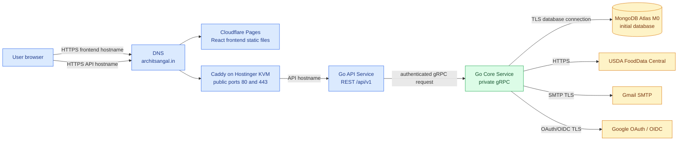
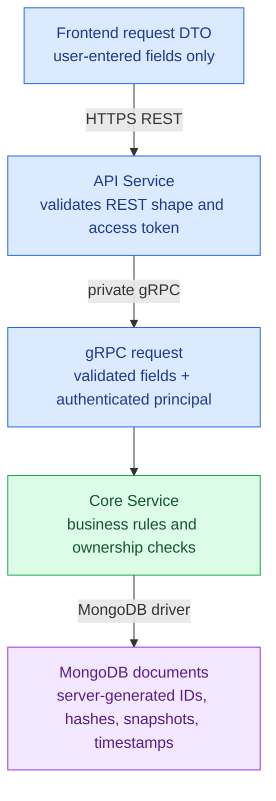
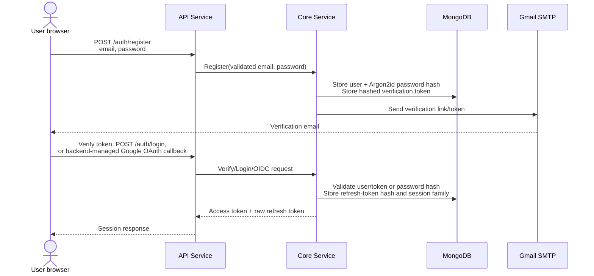
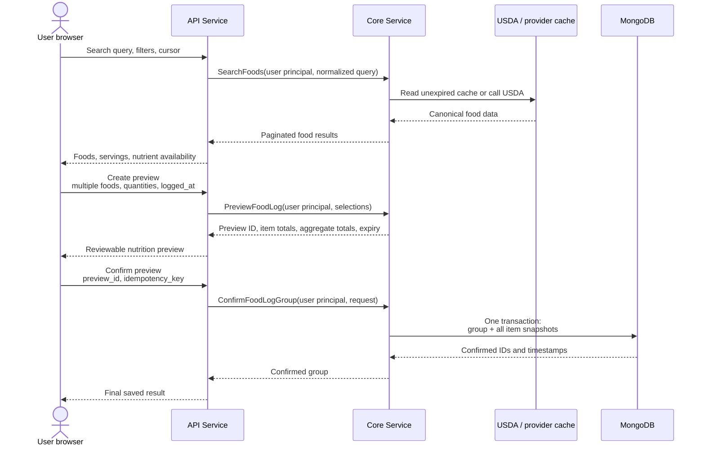
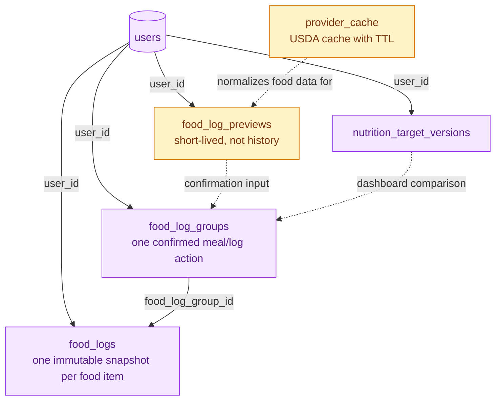
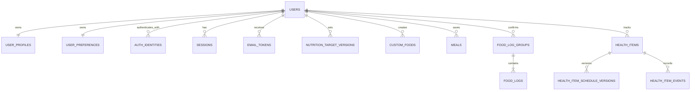
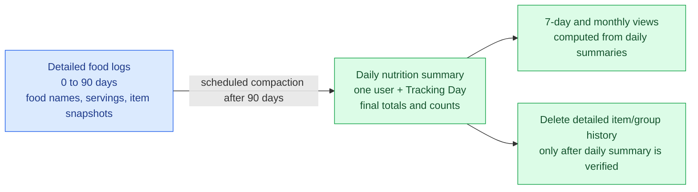
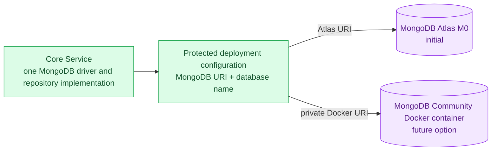
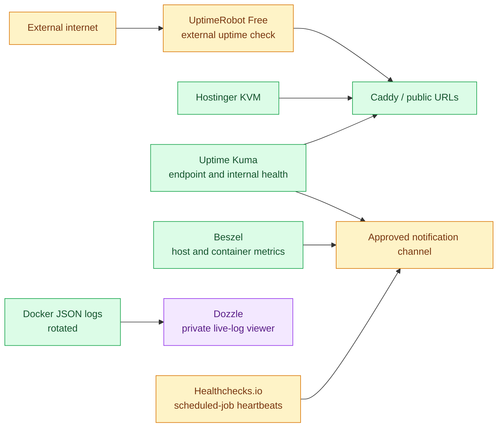
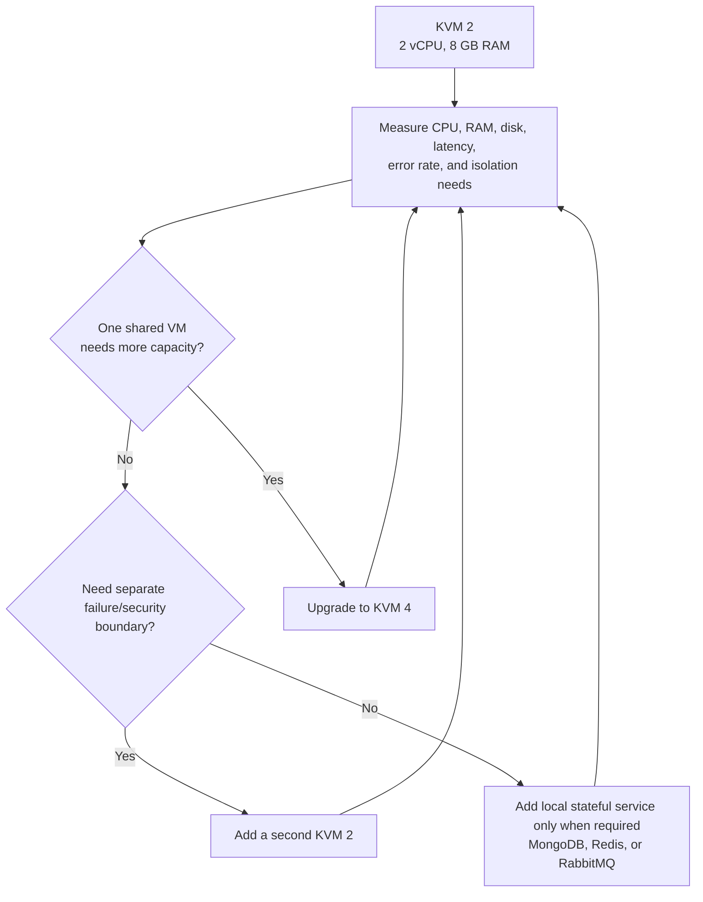

# AteThat — Architecture Visual Summary

| Field | Value |
|---|---|
| Purpose | Visual companion to the system, database, and deployment designs |
| Scope | Phase 1 architecture and the agreed deployment direction |
| Source of truth | `3. SYSTEM_DESIGN.md`, `4. DATABASE_DESIGN.md`, and `DEPLOYMENT.md` |

This document shows the important boundaries, request flows, data passed between layers, and database storage model. It summarizes rather than replaces the source design documents.

## 1. Complete system and deployment view



### Public and private boundaries

| Location | Accessible from the internet? | What it handles |
|---|---|---|
| Cloudflare Pages | Yes | TLS static frontend delivery |
| Caddy | Yes | API TLS, HTTP-to-HTTPS redirect, hostname routing |
| API Service | Yes, through Caddy | REST input validation, rate limits, authentication, HTTP-to-gRPC translation |
| Core Service | No | Domain rules, persistence, USDA access, email sending |
| MongoDB | No browser/API access | Authoritative user data |

The browser never receives database credentials, USDA credentials, Gmail credentials, or Core Service access.

## 2. What crosses each application boundary



| Flow | Browser sends | Internal service receives/creates | Stored data |
|---|---|---|---|
| Registration | Email, password, agreed profile inputs | Normalized email; password is immediately hashed; verification token is created | User, auth identity, hashed verification token |
| Login | Email/password or Google OAuth start/callback | Authenticated user/session result; verified Google subject for Google sign-in | Password hash where applicable; Google provider/subject only; refresh-token hash and session metadata; never raw password, provider token, or refresh token |
| Food search | Search text, filters, cursor/page size | Authenticated principal plus normalized query | Short-lived shared USDA cache only when fetched |
| Food preview | Selected food IDs, serving/quantity, food state, logged timestamp | Canonical nutrition calculation and preview | Short-lived preview with expiry |
| Food confirmation | `preview_id`, idempotency key, final user confirmation | User ID from access token; transaction request | One group and one-or-more immutable food-log snapshots |
| Dashboard/history | Date range, cursor/page size | User ID from access token; Tracking Day calculations | Reads only; no client-supplied ownership is trusted |
| Health action | Item/schedule/event input and timestamp | User ID, schedule interpretation, UTC normalization | Health item, schedule version, or occurrence event |

## 3. Authentication and account recovery



```text
Never stored or logged: raw password, raw refresh token, raw email-verification token,
database URI, Gmail app password, USDA key, or token-signing key.
```

## 4. Food logging: preview to immutable history



The confirmation transaction is all-or-nothing. A group may contain many food items; it never creates a partially confirmed meal.

## 5. Food-log data shape and ownership



| Collection | Main fields | Why it exists |
|---|---|---|
| `food_log_groups` | `user_id`, Tracking Day, logged UTC time, status, item count, aggregate final nutrition, revision | Represents one user confirmation action, including a multi-food meal |
| `food_logs` | `user_id`, group ID, food source/name snapshot, quantity, provider/final nutrition snapshots, timestamps | Preserves each food item as historical evidence |
| `food_log_previews` | User ID, chosen items, calculated totals, expiry | Lets the user review totals before persistence |
| `provider_cache` | USDA cache key, normalized food/search payload, fetched/expiry timestamps | Reduces repeated provider calls; never becomes permanent history |

All user-owned collections carry `user_id`, and Core Service queries bind it from the authenticated session—not from a request-body field.

## 6. Other stored user data



| Data family | Storage rule |
|---|---|
| Identity and sessions | Passwords/tokens are stored only as hashes; expired session/token documents use TTL indexes |
| Profile and preferences | Stores user default timezone and Tracking Day preferences; timestamps remain UTC |
| Targets | Versions are retained so historical comparisons remain explainable |
| Custom foods and meals | Reusable user-owned definitions; changing them does not rewrite confirmed food history |
| Health items | Definitions, schedule versions, and recorded events remain distinct from food logs |

## 7. Detailed-history compaction

> This is an agreed Phase 1 retention rule and is represented in the database design.



```text
Before 90 days: exact foods and individual servings are available.
After 90 days: daily totals remain available, but exact food-item history is no longer available.
```

Daily summaries are sufficient for weekly and monthly calculations; a permanent monthly copy is not required unless later performance measurements justify a materialized rollup. Compacted days are read-only because their item-level evidence no longer exists.

## 8. Database deployment portability



Both database targets use the same collections, indexes, and transaction behavior. If local MongoDB is adopted, it must be authenticated, private to Docker networking, persist to a volume, and run as a single-node replica set.

## 9. Monitoring, logging, and alerting view



An external uptime monitor is essential because KVM-local monitoring cannot report an outage when the entire VM, Docker daemon, or network path is unavailable.

## 10. Capacity and future scaling choices



KVM 2 is the current cost-first deployment choice. Redis and RabbitMQ are optional future components, not initial AteThat dependencies.
